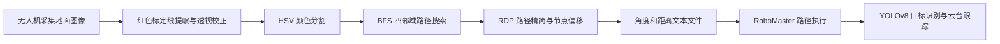
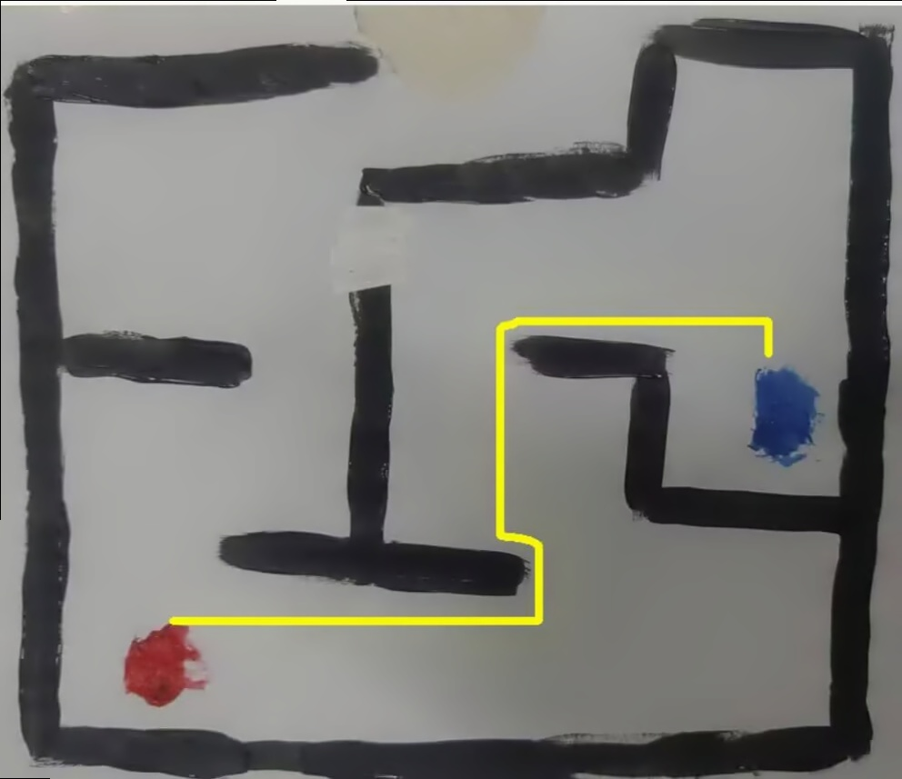
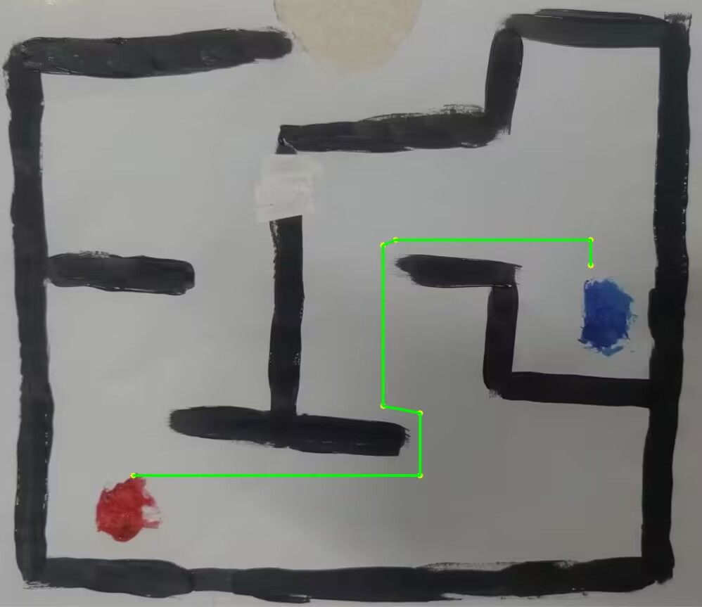

# 地空机器人协同目标识别与信息交互

基于 **DJI Tello / RoboMaster 无人机接口、RoboMaster EP、OpenCV 与 YOLOv8** 的新生项目代码归档。项目通过无人机获取地面图像，在电脑端完成地图校正与路径规划，再以距离、角度文件衔接地面机器人的运动与视觉识别。

本仓库以“2-7 组新生项目汇总”中的结题源码为主，补充有代表性的早期实验。**原始源码逐字节保留**；目录组织、说明文档和 `tools/` 工具为此次整理新增。代码属于特定场地的实验原型，硬件全流程尚未在此次整理中复测。

## 技术流程



当前归档通过文件交换数据，未找到统一调度服务或独立的机器人间通信协议实现。

## 结题效果

以下图片来自原结题材料，不代表此次重新运行的测试结果。

| 路径规划 | 转折节点 |
| --- | --- |
|  |  |

## 目录

```text
final_code/
  drone/                 结题无人机采图代码，两种 SDK 入口
  processing/            地图校正、颜色分割、BFS、RDP、角度与距离换算
  ground_robot/          小车路径执行、YOLOv8 识别与云台控制
experiments/
  drone/                 手动采图、红色标记对齐、S 形搜索
  planning/              两个单文件路径规划实验及其输入图
  vision/                HSV、电脑摄像头 YOLO、手机和香蕉识别实验
  stitching/             ORB 拼接实验及原始输入图
assets/                  精选地图、采图和结题效果图
docs/                    运行指南、已知限制、文件来源与验证记录
tools/                   新增离线运行入口与归档校验工具
```

## 快速开始

先验证归档完整性，无需安装机器人 SDK，也不会启动任何设备：

```powershell
python tools/verify_archive.py
```

离线图像处理建议使用单独的 Python 3.10 或 3.11 环境：

```powershell
python -m venv .venv
.\.venv\Scripts\python.exe -m pip install -r requirements.txt
.\.venv\Scripts\python.exe tools/run_planning.py --image assets/drone_capture.jpg
```

`requirements.txt` 是根据源码导入关系整理的兼容范围，并非原项目的完整锁定环境。上面的命令用于复现原始 `All.py`，运行文件自动放入 `runtime/`。**当前样例会在标定线提取后报 `IndexError`，完整结题流程尚未复现成功。** 已通过的是合成地图上的核心函数离线检查；单文件图像规划实验虽然正常结束，但配套图片没有生成黄色路径。详见 [验证记录](docs/VALIDATION.md)。校正和分割参数依赖具体场地，不能对任意图片直接使用。

连接设备前请阅读 [运行指南](docs/USAGE.md) 和 [已知限制](docs/KNOWN_LIMITATIONS.md)。部分原始脚本在导入时便连接设备；本仓库的离线检查只解析源码，不导入硬件模块。

## 主要入口

| 文件 | 作用 |
| --- | --- |
| `final_code/drone/fly.py` | djitellopy 采图、起降与重试处理 |
| `final_code/drone/drone.py` | RoboMaster Drone 接口采图 |
| `final_code/processing/All.py` | 结题图像处理与路径规划总入口 |
| `final_code/processing/line_test.py` | DBSCAN 聚类、直线拟合和透视校正；虽含 test 字样，但不是测试文件 |
| `final_code/processing/path.py` | BFS、RDP 和路径节点偏移 |
| `final_code/processing/angle.py` | 路径转角与实际距离换算 |
| `final_code/ground_robot/car_move.py` | 地面移动、YOLOv8 推理与云台控制 |

## 归档范围与来源

完整复制来源见 [文件来源清单](docs/SOURCES.md)，机器可读的 SHA-256 清单见 [source_manifest.json](docs/source_manifest.json)。实验选择及未纳入内容见 [整理说明](docs/ARCHIVE_NOTES.md)。

安装器、开发环境、模型权重、第三方完整源码、大数据集、重复草稿未纳入仓库。原始报告包含个人信息，仓库用技术摘要替代；报告、答辩 PPT 和演示视频仍保留在原项目目录。

## 作者与第三方依赖

本仓库归档 2-7 组新生项目成果；代码及素材的来源和原有注释均保留。没有根据目录持有人擅自重写作者归属，也未替团队选择开源许可证。第三方库及模型遵循各自的许可，详见 [第三方说明](THIRD_PARTY_NOTICES.md)。
